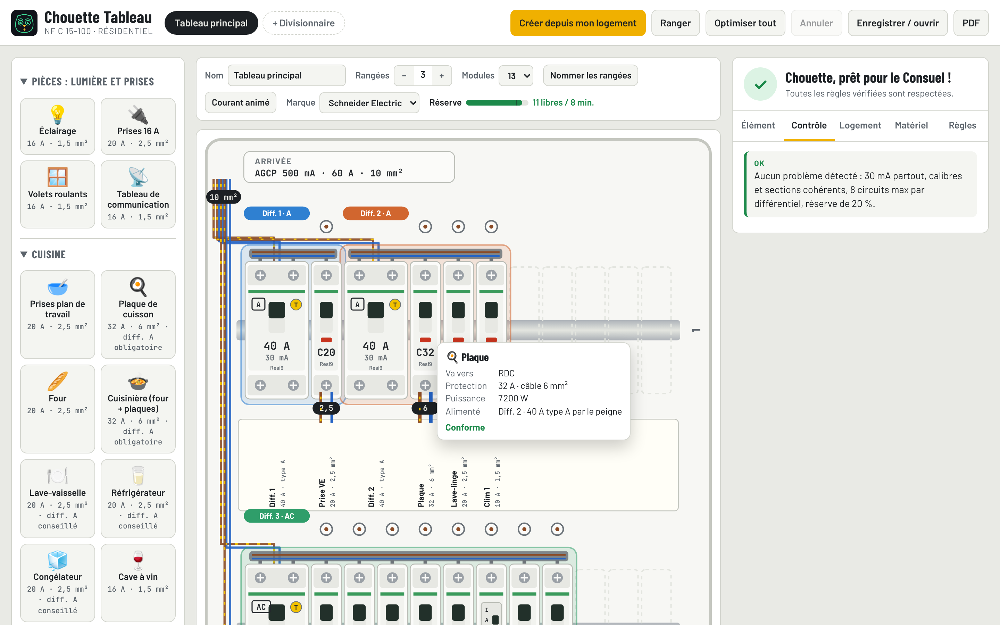

<p align="center"></p>

<h1 align="center">Chouette Tableau</h1>

<p align="center">
  <b>Dessine ton tableau électrique en glissant les disjoncteurs.<br>Il vérifie la norme NF C 15-100 au fur et à mesure.</b>
</p>

<p align="center">
  <a href="https://nodyxstudio.github.io/chouette-tableau/"><b>▶ Ouvrir Chouette Tableau</b></a>
  · gratuit · sans compte · rien à installer
</p>

<p align="center">
  <a href="https://nodyxstudio.github.io/chouette-tableau/"></a>
</p>

---

Tu glisses un four, une clim ou des prises sur une rangée : le bon disjoncteur et la bonne section de câble sont choisis tout seuls. À droite, le contrôle te dit ce que le Consuel refuserait, pourquoi, et propose de corriger en un clic.

## Ce qu’il fait

- **Glisser-déposer** : un appareil (four, clim, prises…) déposé sur une rangée devient un disjoncteur, avec le bon calibre et la bonne section de câble.
- **Câblage** : un disjoncteur posé à droite d’un interrupteur différentiel est alimenté par le peigne. On peut aussi tirer un fil depuis le rond au-dessus du disjoncteur jusqu’à un différentiel.
- **Contrôle en direct** des règles vérifiées par le Consuel :
  - 30 mA partout, 8 circuits maximum par différentiel ;
  - type A pour la plaque, le lave-linge et la recharge de véhicule ;
  - calibre compatible avec la section du câble ;
  - nombre maximum de prises et de points lumineux par circuit ;
  - nombre minimum de différentiels selon la surface ;
  - 20 % de réserve, repérage des circuits, parafoudre, tableau divisionnaire.
- **Bilan de puissance** : puissance appelée et abonnement conseillé. La clim et la recharge du véhicule sont comptées.
- **Tableaux divisionnaires** : un départ 32 A / 6 mm², 40 A / 10 mm² ou 63 A / 16 mm² à glisser dans le tableau principal. Il se branche sur le câble d’arrivée de l’AGCP (avant les différentiels) ou derrière un différentiel. Le tableau divisionnaire est créé tout seul.
- **Section sur chaque fil** : départs, arrivée et liaisons en fil, en mm².
- **Guide des différentiels AC / A / F / B** selon les appareils (clim, PAC, induction, lave-linge, recharge…).
- **Réglage rapide** : choisir le calibre adapte la section du câble, et inversement. La liste « Circuits » sous le tableau permet de tout modifier d’un coup.
- **« Ranger »** compacte le tableau sans changer tes différentiels. **« Optimiser tout »** répartit tous les circuits selon les règles. Les flèches du clavier déplacent le module sélectionné.
- **Bulle au survol** : passer la souris sur un disjoncteur affiche où il va (pièce, étage, tableau), sa protection, sa puissance et le différentiel qui l’alimente.
- **Étages** : chaque circuit a un étage et une pièce. Conseils si l’éclairage et les prises d’un étage dépendent du même différentiel, ou s’il vaut mieux un divisionnaire à l’étage.
- **Couleurs par différentiel** : chaque différentiel et les disjoncteurs qu’il protège partagent une couleur. Les problèmes proposent une correction en un clic.
- **Câble d’arrivée** au choix (10, 16 ou 25 mm²), avec contrôle par rapport au réglage de l’AGCP.
- **Appareils** : réfrigérateur, cave à vin, micro-ondes, hotte, cuisinière, sèche-serviettes, plancher chauffant, ballon thermodynamique, chaudière, piscine, spa, portail, alarme, aspiration centralisée, pompe…
- **Modèles de divisionnaire** : atelier (bâtiment séparé), garage, étage, abri de jardin, piscine ou vide, avec circuits, interrupteur de tête, différentiels et départ.
- **Chute de tension** : indique la longueur d’un câble, l’outil calcule la chute et propose la bonne section.
- **Tester un différentiel** : il « saute », ses circuits s’éteignent et le courant animé s’arrête dans les fils.
- **Rangées nommées**, repères enregistrés pendant la frappe, guide de démarrage.
- **Enregistrer / ouvrir** un fichier projet, **export PDF**, écran d’accueil (continuer, ouvrir, créer).
- **Prix indicatifs** (TTC, modifiables) et budget du tableau, par marque.
- **Contrôle immédiat** à chaque disjoncteur posé ou modifié : courant = puissance ÷ 230 V comparé au calibre, marge, câble.
- **Matériel** : gammes Schneider (Resi9) ou Legrand (DX³), liste d’achat selon ton stock.
- **Assistant « Créer depuis mon logement »** : génère un tableau complet et conforme à partir de quelques questions.
- **Manipulation** : toucher un module ouvre une barre Régler / Dupliquer / Supprimer. On peut aussi glisser un module vers la corbeille. Un module lâché entre deux autres s'insère et décale la rangée.

> Aide à la conception. Ne remplace ni l’attestation du Consuel ni les notices des fabricants. Les modules sont des illustrations.

## Utiliser

**En ligne :** https://nodyxstudio.github.io/chouette-tableau/

Aucune installation et aucun compte. Chaque personne travaille dans son navigateur. Pour garder un tableau, **Enregistrer / ouvrir → Enregistrer sur mon ordinateur** crée un fichier `.tableau.json`, qu’on rouvre plus tard avec **Ouvrir un fichier**. **PDF** exporte le schéma, les circuits, le contrôle et le matériel. Rien n’est envoyé sur un serveur.

En local : ouvrir `index.html` avec `regles.js` dans le même dossier.

## Organisation

| Fichier | Rôle |
|---|---|
| `regles.js` | Règles NF C 15-100 : données (sections, calibres, limites), calculs, rangement automatique, vérification. Pas de DOM. |
| `app.html` | Interface : dessin du tableau, glisser-déposer, panneaux. |
| `tests/regles.test.js` | Tests des règles (Node 18+). |
| `build.sh` | Génère `index.html` (page autonome) à partir de `app.html`. |

```bash
npm test
```

```bash
./build.sh
```
